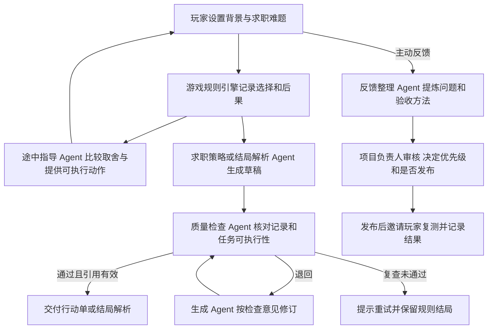

# Finding Work 模拟器 · AI 赛道提交材料草稿

## 1. 项目介绍页

| 项目 | 可填写内容 |
|---|---|
| 参赛主体／公司名称 | 【填报名表登记的真实主体名称。若以个人参赛，按赛事允许的格式填写。】 |
| 项目名称 | Finding Work 模拟器（FW） |
| 一句话定位 | 面向还没正式求职的计算机学生，用一局可玩的职业模拟，让他们提前看懂实习、校招和 Offer 里的取舍，再用 Xiaomi MiMo 带走一份七天行动单。 |
| 目标用户 | 核心用户是尚未投递过实习、缺少面试或 Offer 经验的大二、大三计算机学生。准备首次校招、第一次换技术方向的学生也可以用定制路线练习。 |
| 产品定价 | 随机人生免费，定制路线当前免费试用。拟验证按次收费，定价假设为 ¥9.90／份定制路线复盘与行动单，尚未上线收费。 |
| 产品链接 | [FW 模拟器](https://fw.jobspark.website) |
| 代码版本 | 线上对应提交 `23b5c49`。提交前补上评委可访问的仓库链接并核对该提交。Vercel 直传不会自动同步 GitHub。 |

**介绍页标题。** 第一次求职，先试玩一局。

**30 秒介绍。** 第一次找实习，很多同学连「投递成功」「收到 Offer」「接受岗位」分别意味着什么都还没经历过。FW 让你随机抽一个学生身份，在十几个关键抉择里体验投简历、等回复、选城市和权衡收入。你可以重玩，看看换一个选择会把这段经历带到哪里。遇到自己也在担心的难题，再切到定制路线，让 Xiaomi MiMo 帮你比较取舍，带走一份能执行的七天行动单。

**为什么学生会用。** 随机开局、不同去向和可回看的选择让第一次接触招聘变成一局有结果的游戏。玩家看见具体任务、城市生活预算和实际接受的岗位，更容易理解每一步发生了什么。定制路线延续同样的玩法，让玩家把「好奇一个职业」变成「这周可以先验证哪一步」。

**商业化假设。** 免费模拟负责吸引首次接触求职的学生。需要针对自身情况比较路线时，可以试用 MiMo 定制复盘和七天行动单。优先验证玩家愿不愿意照着做一个动作，再验证是否愿意为一次复盘付费。目前五位真实试玩者提供了定性反馈，尚未证明付费转化。

## 2. 三分钟内演示脚本

已录制带字幕的生产站演示，使用虚拟角色和真实模型调用。下表可用于后续配旁白或加录复测片段，完整版控制在 3 分钟内。

| 时间 | 画面与解说 |
|---|---|
| 00:00–00:20 | 打开自定义域名，展示随机开局档案。「第一次找实习？先用一个随机身份，看看招聘会在哪些地方让你做选择。」 |
| 00:20–00:45 | 定制路线选择「Offer 与合同」、每周 3 小时、两周内希望看到进展。「本地团队后天要回复，另一家还在终面。」 |
| 00:45–01:18 | 展示关卡与并排的 MiMo 窗口，问「后天要回复，我应该先确认什么？帮我拟一句能发给招聘方的话。」镜头保留玩家仍可选择。 |
| 01:18–01:52 | 用该局实际发生的机会确认、拒绝或申请结果演示。结局展开「选择怎样走到结果」，读出一条真实选择及后果。 |
| 01:52–02:22 | 展示同局生成的行动单，只读一项有耗时和完成标准的任务，以及何时切换备选策略。展示检查结果和下载。 |
| 02:22–02:50 | 展示 D 的匿名反馈、上线改动和一条真实调用日志。已有复测时展示复测结果。尚未复测时如实标注待复测。 |

## 3. Agent 组织架构图

玩家决定路线和是否接受岗位。Agent 可以提出建议、生成内容、核对依据、退回草稿及整理反馈。项目负责人决定修改规则、调数值、发布和组织复测。反馈与运行摘要目前保存在浏览器，由试玩者主动导出或由负责人收集。

| 角色 | 收到什么 | 交给谁 | 自主权与边界 |
|---|---|---|---|
| 途中指导 Agent | 当前关卡、可选行动、角色约束及玩家问题 | 将取舍和可执行动作直接给玩家 | 可以追问和拟话术，玩家决定怎么选。 |
| 策略／解析 Agent | 本局经历、实际岗位、起始目标、可用时间和期限 | 向检查 Agent 提交初稿 | 按本局记录生成路线解释或七天行动单。 |
| 质量检查 Agent | 初稿和原始经历 | 向策略 Agent 退回具体问题，或把通过的内容交付玩家 | 核对虚构经历、实际去向、时间预算、行动标准。有限重试后仍失败就提示重试。 |
| 反馈整理 Agent | 玩家主动提交的意见与本局背景 | 向项目负责人汇报问题、建议和验收方法 | 整理意见和提出方案，负责人判断是否采纳、何时发布。 |

这些是同一 Xiaomi MiMo 服务承担的不同任务角色。代码已实现玩家请求触发、检查、退回修订和再次检查。经营侧目前由人主动收集反馈和触发任务，架构图应把人工步骤标清。

## 4. 运行日志与 40+ 小时经营流水

**Agent 运行日志字段**

| 时间 | 工作流 ID | 任务 | 环境 | 结果 | 耗时 | Token | 证据 |
|---|---|---|---|---|---|---|---|
| 【实际时间】 | 【运行记录页或导出文件】 | 途中指导／求职策略／质量检查／反馈整理 | 生产／测试 | 成功／失败／重试 | 【实际】 | 【实际】 | 【匿名截图或导出文件】 |

已经验证过生产域名的途中指导和求职行动单，行动单通过质量检查。自动模拟及测试角色真实调用均作为测试证据记录，分别注明。录制时在同一设备进入「运行记录」导出，提交前移除个人信息。

**经营流水字段**

| 实际时间 | 做了什么 | 参与角色 | 发现或产出 | 状态／证据 |
|---|---|---|---|---|
| 【补实际时间】 | 首轮收集五位朋友反馈 | A–E | 焦虑、行动门槛、节奏、界面、选择与结果关系。其中 C、D 已知是计算机专业。 | 真实口头反馈，可补匿名原话或截图 |
| 【补实际时间】 | 根据 D 的反馈迭代招聘流程 | 负责人 | 把投递、获得机会和接受岗位分开。结局解释实际选择、去向、收入区间及城市预算。 | 线上已发布，提交 `f3c57ed` |
| 【补实际时间】 | 补毕业后求职和结局解释 | 负责人 | 未落实岗位时新增继续投目标方向、本地带教团队、过渡工作或整理经历；结局记录申请是否产生 Offer。 | 线上已发布，提交 `23b5c49` |
| 【补实际时间】 | 外部移动网络验收 | 负责人／试玩者 | 原托管域名在手机打不开，自定义域名可打开。生产 MiMo 聊天及行动单成功。 | 可补公开入口与调用截图 |
| 2026-11-08 13:36（北京时间） | 反馈 Agent 汇总五位玩家的匿名反馈 | 负责人、反馈 Agent | 建议优先复测选择与去向、收入的关系，提出关键选择后显示影响来源。 | 真实生产运行，10.42 秒，859 Token；属于发布后复盘 |
| 【实际发生后填】 | 根据已上线版本复测 | 负责人、试玩者 | 用 D 的问题验收：为什么去了这个岗位？哪次选择影响收入？如果尚未就业，能否看清最后一次申请发生了什么？ | 待完成，不填写预期为实测结果 |

### 首轮五位真实玩家的评价

| 玩家 | 背景 | 认可或价值信号 | 不足或阻碍 | 处理及复测状态 |
|---|---|---|---|---|
| A | 非计算机专业 | 未明确给出认可点 | 求职情境让自己焦虑，觉得不适合，婉拒另一个模式 | 已记录受众边界和压力反馈。尊重其选择，无复测。 |
| B | 非计算机专业 | 从虚拟角色角度体验，整体觉得还可以 | 不了解行业，担心有些选择即使选了，现实里也很难做到 | 将选项的行动门槛列为后续检查项。具体卡在哪些选项尚待定位。 |
| C | 计算机专业 | 认可场景真实性「还可以」 | 选择过多、节奏太慢，界面 AI 味重 | 随机模式已缩为 16 个主节点，并精简部分页面信息。待目标用户复测。 |
| D | 计算机专业 | 给出了可用于校准岗位、城市和企业类型的具体维度 | 收入与中途选择的联系不清晰，出现不想去的实习方向，认为模拟收入偏低；六个月实习选项太僵硬 | 岗位确认、收入来源、选择到结果和实习协商已更新。薪资档位仍是模拟参数，实际感受待复测。 |
| E | 专业未记录 | 未明确给出认可点 | 和 A 一样觉得容易焦虑，也认为部分选择与结果的联系不清楚 | 已在结局保留申请是否获得 Offer 的解释，并增加毕业后的可行选项。待复测。 |

用实际开始、结束时间和带时间的证据覆盖比赛要求的经营区间。现有材料未证明完整的 40+ 小时。

## 5. 加分材料与最后检查

- **真实转化。** 记录一位愿意参加路线复盘的试玩者的预约或意向。记录同意、时间和所选服务。实际未付款时注明「预约／意向」，有模拟成交时另行标注。
- **成本对照。** 对同一份案例记录 Agent 各步骤实际 Token 和耗时。使用账单或资源后台的真实调用费用，再记录人工完成同等复盘的用时；缺少分项费用时标为未统计。指标可用「每份通过检查的行动单成本」。
- **提交前核对。** 真实主体名称、价格状态、3 分钟以内视频、生产链接、评委可访问的代码仓库、架构图、运行日志、经营流水分别准备。
- **优先补两条证据。** 一位玩家说出愿意本周尝试的具体动作，以及一条真实反馈经过 Agent 整理、负责人改动和玩家复测。
